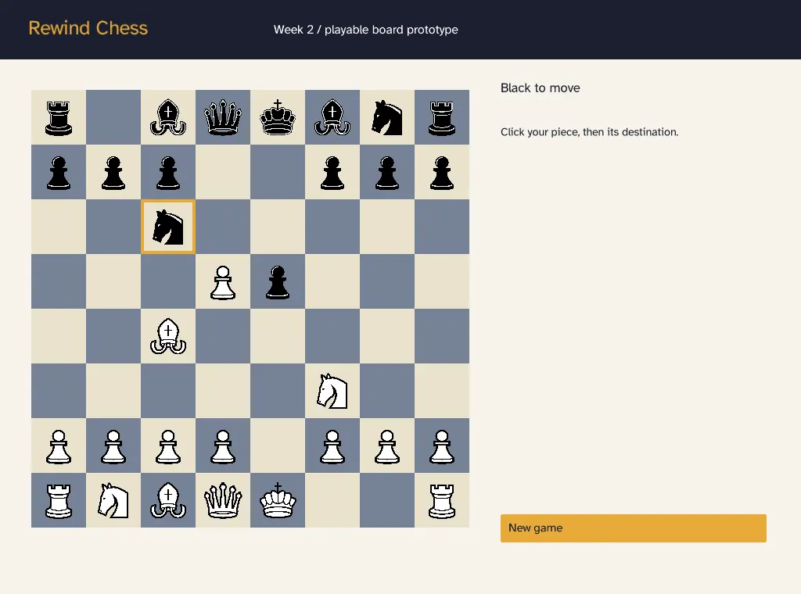

# Sprint 2 prototype: structure and usage

**Author:** Filip Sekulovski · **Sprint 2 deliverable** ("Document the prototype structure and usage") · Applies to commit `8e8fc0a` ("week 2 core game code update")



## 1. What the prototype does

A local chessboard for two players:

- Starts from the standard position; White moves first.
- Every piece moves according to its basic rule; sliding pieces are blocked by other pieces.
- Enemy pieces can be captured; your own pieces and kings cannot.
- Turns alternate after every valid move.

Not included yet: check and checkmate, castling, en passant, promotion, draws, history, rewinds, game modes and abilities. A pawn that reaches the last rank stays a pawn and cannot move again.

## 2. Build and run

See the **Build and run** section of the main [`README.md`](../README.md). In short (PowerShell, in the folder with `CMakeLists.txt`):

```powershell
$buildFolder = Join-Path "..\..\RewindChess-weekly-build" (Split-Path -Leaf $PWD)
cmake -S . -B "$buildFolder" -G Ninja -DCMAKE_BUILD_TYPE=Release
cmake --build "$buildFolder" --parallel
& "$buildFolder\RewindChess.exe"
```

## 3. The window

```text
┌───────────────────────────────────────────────────────────────┐
│ Rewind Chess          Week 2 / playable board prototype        │  header
├──────────────────────────────┬────────────────────────────────┤
│                              │ White to move                  │  status
│        8 × 8 board           │ Click your piece, then its     │
│        (a8 top-left)         │ destination.                   │
│                              │                                │
│                              │ [ New game ]                   │
├──────────────────────────────┴────────────────────────────────┤
│ red hint after an invalid click                               │  notice
└───────────────────────────────────────────────────────────────┘
```

The window starts at 1024 × 760, can be resized down to 720 × 540, and the whole scene scales with it.

## 4. Controls

| Action | How |
|---|---|
| Select a piece | Click one of your own pieces. It gets an amber frame. |
| Move | With a piece selected, click a legal destination square. |
| Change selection | Click another of your own pieces. |
| Cancel | Press **Esc**. (Esc does not close the window; use the window's close button.) |
| Invalid click | Clicking an empty square, an enemy piece that cannot be captured, or a piece of the other side clears the selection and shows "Select your piece, then a valid destination." |
| Restart | Click **New game**. |

## 5. How a click flows through the code

```text
App::run()                       every frame: read mouse, convert to 1024×760 coordinates
 └─ App::drawBoard()             draws squares and pieces; on a click inside the board:
     ├─ game_.availableMoves()   → getLegalMoves(state) → isLegalMove() for all square pairs
     ├─ if (selected → clicked) is in the list:  App::commit(move)
     │     └─ Game::play(move)   → isLegalMove() again → applyMove() → turn switches
     └─ otherwise: select the clicked piece if it belongs to the player to move,
                   or clear the selection and show the hint
```

The interface never edits the board itself; it only asks `Game` to play a move. This keeps the rules in one place (`Rules.cpp`) for the later sprints. Classes and conventions are described in [`architecture-and-conventions.md`](architecture-and-conventions.md).

## 6. Checking that it works

Engine checks (no raylib needed), from the repository root:

```powershell
g++ -std=c++17 -Wall -Wextra qa/tests/engine_checks.cpp -o engine_checks.exe
.\engine_checks.exe
```

Expected last line: `Result: 40 passed, 0 failed`. The manual UI checklist and known issues are in [`qa/test-plan-sprint2.md`](../qa/test-plan-sprint2.md) and [`qa/issues.md`](../qa/issues.md).
